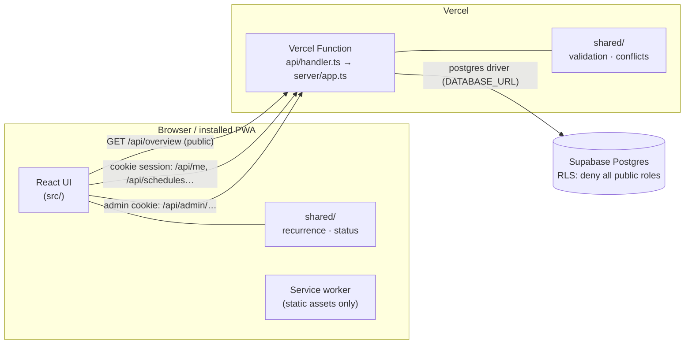

# Architecture and data flow

## Overview



- **One codebase, one deployment.** Static frontend + a single Node function on Vercel. All `/api/*` paths are
  rewritten to `api/handler.ts`, which dispatches with a small router (`server/app.ts`).
- **Shared domain logic** (`shared/`) is imported by the browser and the server, so the status the user sees and
  the rules the server enforces are the same code.
- **Database access only from the server** with a privileged connection. Browsers never receive database
  credentials. RLS is enabled on every table without policies, and privileges are revoked from `anon`/`authenticated`.

## Data model

| Table | Purpose |
|---|---|
| `apartments` | name, `access_code_hash` (scrypt), `code_updated_at` |
| `parking_spaces` | `space_number` (unique), `apartment_id` (nullable, configurable) |
| `availability_schedules` | one row per one-off period **or** recurring series: first occurrence `start_datetime`/`end_datetime` (UTC), `recurrence_type` (`none`/`daily`/`weekly`/`weekdays`), `recurrence_days` (ISO 1–7), `recurrence_end_date` (local date, inclusive), `timezone`, `is_active` |
| `availability_exceptions` | per-occurrence overrides keyed by `(schedule_id, occurrence_date)`: `cancelled` or `modified` (new start/end) |
| `reservations` | concrete period (UTC start/end) on a space, reserved by an apartment; deleted when cancelled |
| `notifications` | in-app notices for an apartment (`kind`, JSON details, `read_at`); purged after 30 days |
| `sessions` | SHA-256 of session tokens, kind (`apartment`/`admin`), expiry |
| `login_attempts` | hashed client key + result, for rate limiting |
| `activity_log` | who did what (actor, action, space, apartment, JSON details) |
| `app_migrations` | applied migration files |

Future occurrences are **never stored**. They are derived on demand, which makes edits, exceptions, pausing and
"this and following" splits simple and consistent.

## Recurrence and time handling

- All instants are stored in UTC; each schedule also stores the building's IANA timezone.
- An occurrence on local date *d* is built from the **wall-clock** template: start = *d* + start time,
  end = *d* + day offset + end time, converted with Luxon in the building timezone. A daily 08:00–17:00 period
  therefore stays 08:00–17:00 across DST changes; overnight periods simply become 7 or 9 hours long on the
  change nights, and back-to-back periods stay seamless.
- `weekly` repeats on the weekday of the start date, `weekdays` on the selected ISO weekdays; the series start date
  is the earliest possible date. `recurrence_end_date` is the last date an occurrence may start.
- Exceptions: `cancelled` removes one occurrence; `modified` replaces it with explicit times.
- Editing scopes:
  - **This date** → upsert a `modified` exception (delete → `cancelled` exception)
  - **This and following** → end the existing series the day before and insert a new series from that date
    (exceptions from that date on are removed)
  - **Entire series** → update the series row
- The building timezone is independent of the UI language; the language only changes wording and formatting.

## Status calculation (no background jobs)

`GET /api/overview` expands active schedules for the next 7 days, merges overlapping/back-to-back occurrences per
space, and returns only `{ space, start, end }` blocks. The browser recomputes each space's status every
30 seconds from those blocks and the current time:

- **available** – a block contains *now* (shown with "until …", merged across back-to-back blocks)
- **upcoming** – the next block starts within 7 days
- **occupied** – otherwise (the default; also automatically after a period ends)

The overview is refreshed every 60 s while visible, when the tab becomes visible and when the connection returns.

## Writing availability

```mermaid
sequenceDiagram
  participant B as Browser
  participant A as API (Vercel)
  participant D as Postgres
  B->>A: POST /api/schedules {parkingSpaceId, startDate, startTime, endDate, endTime, repeat}
  A->>A: session cookie → apartment; space belongs to apartment?
  A->>A: validate wall-clock input (shared/validation)
  A->>D: BEGIN; pg_advisory_xact_lock(space)
  A->>D: load schedules + exceptions of this space
  A->>A: findConflict (shared/conflicts): expand ≥ 1 year past the latest start
  alt overlap
    A-->>B: 409 conflict {spaceNumber, start, end}
  else ok
    A->>D: INSERT schedule; INSERT activity_log; COMMIT
    A-->>B: 200
  end
```

The per-space advisory lock serialises concurrent edits so two requests cannot create overlapping periods.
Weekly patterns repeat, so checking one year (371 days) beyond the latest start also covers all DST variations.

## Reservations

- A reservation must lie completely inside the space's availability, must not overlap another reservation and
  cannot be made on the apartment's own spaces. Checked server-side under the same per-space lock as availability.
- Status: reserved time is subtracted from availability (`freePeriods`). A space is **reserved** while a
  reservation is running, otherwise available/upcoming based on the remaining free periods.
- Owner protection: every availability change (edit, delete, pause – also by the admin) is re-validated; if
  any future reservation would no longer be covered, the change is refused (`409 reserved`).
- Cancelling: the reserving apartment and the administrator can always cancel. The space owner can remove a
  reservation only before it starts (`POST /api/reservations/:id/cancel` with optional `message` ≤ 200 chars and
  `removeAvailability`). With `removeAvailability` the reserved period is cut out of the availability under the
  space lock: one-off periods are shortened/split/deleted, recurring dates get a `modified`/`cancelled` exception
  (plus a one-off for a remainder after the gap).
- Notices: when the owner or the administrator cancels, a `notifications` row is written for the reserving
  apartment in the same transaction. `GET /api/notifications` returns unread notices (empty for anonymous
  visitors) and is re-checked whenever the overview refreshes; `POST /api/notifications/:id/read` dismisses one.
  No push or e-mail – the notice appears the next time the app is opened.
- `GET /api/overview` adds `reservations: { space, start, end, apartment }[]`; `/api/me` adds the apartment's
  own reservations and reservations on its spaces. The change was purely additive (new table, new fields).

## Authentication and authorisation

| Who | How | Can |
|---|---|---|
| Anyone | – | `GET /api/overview` (space numbers + time ranges only) |
| Apartment | 8-digit code → `ps_session` cookie (180 days, path `/api`) | read and change schedules of spaces currently assigned to the apartment |
| Administrator | password (`ADMIN_PASSWORD_HASH` or `ADMIN_PASSWORD`) → `ps_admin` cookie (8 h, path `/api/admin`) | apartments, codes, assignments, all schedules, activity |

- Codes are checked against every apartment's hash (constant work per attempt) and rate-limited per client and
  globally. Resetting a code deletes all sessions of that apartment.
- Ownership is checked on every request against the *current* space assignment. Requests for another apartment's
  schedule return `404` (no information leak).
- Non-GET requests must be `application/json` and same-origin (Origin header check); cookies are
  `SameSite=Strict`.

## Frontend

- Routes: `/` overview, `/my` resident area (code entry or management), `/admin` (lazy-loaded).
- Progressive disclosure in the availability form: date chips (*Today*, *Tomorrow*, *Other date*), *From*/*Until*;
  *Repeat* and *More options* (multi-day end date) are collapsed by default.
- i18n: `src/i18n/locales/{de,en}.json`, detection (`de*` browser → German, else English), manual choice stored in
  `localStorage`. Dates/times use `de-DE` / `en-GB` formatting in the building timezone.
- Offline: banner, "status from …" notice using the last overview cached in `localStorage` (public data only),
  editing disabled, automatic refresh when back online. The service worker precaches static assets only.

## Local development and tests

The same `createApp()` is used everywhere; only the database driver differs:

| Environment | Driver |
|---|---|
| Vercel | `server/db-postgres.ts` (`postgres`, Supabase pooler) |
| `npm run dev` | `server/dev.ts` → PGlite (Postgres compiled to WASM, in memory) via a Vite middleware |
| Vitest | PGlite with all migrations applied |
